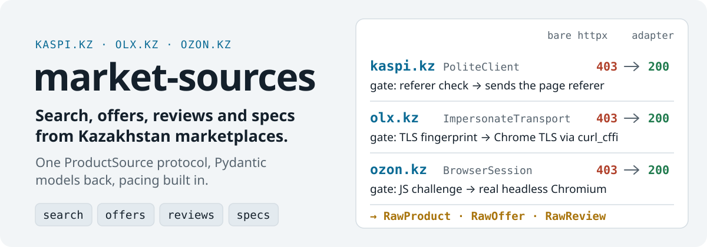
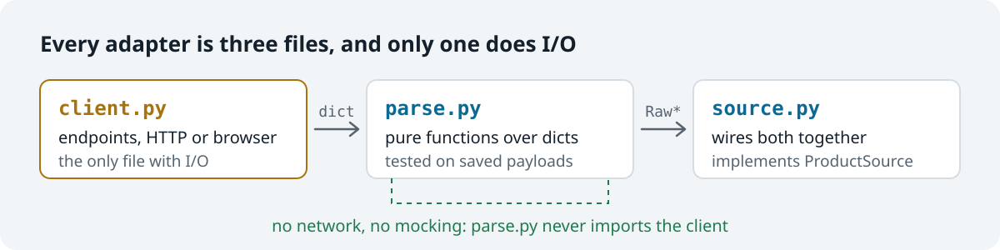

<picture>
  <source media="(max-width: 600px) and (prefers-color-scheme: dark)" srcset="https://raw.githubusercontent.com/octrow/market-sources/main/assets/readme/hero-mobile-dark.svg">
  <source media="(max-width: 600px)" srcset="https://raw.githubusercontent.com/octrow/market-sources/main/assets/readme/hero-mobile-light.svg">
  <source media="(prefers-color-scheme: dark)" srcset="https://raw.githubusercontent.com/octrow/market-sources/main/assets/readme/hero-dark.svg">
  
</picture>

<p align="center">
  <a href="https://github.com/octrow/market-sources/actions/workflows/ci.yml"></a>
  <a href="https://pypi.org/project/market-sources/"></a>
  
  <a href="https://github.com/octrow/market-sources/blob/main/LICENSE"></a>
</p>

<p align="center"><b>English</b> | <a href="https://github.com/octrow/market-sources/blob/main/README.ru.md">Русский</a></p>

Async scrapers for Kaspi.kz, OLX.kz and Ozon.kz, one protocol.

Search a product, get every seller's offer with price and delivery, read reviews and specs.
Use it for price monitors, deal bots and purchase research on Kazakhstan marketplaces.

## Install

```bash
pip install market-sources                  # Kaspi; OLX needs the impersonate extra (below)
pip install "market-sources[impersonate]"   # + curl_cffi, so OLX.kz's WAF lets requests through
pip install "market-sources[browser]"       # + playwright, for Ozon.kz
playwright install chromium                 # once, for the browser extra
```

With uv: `uv add "market-sources[impersonate,browser]"`.
Latest code: `pip install "git+https://github.com/octrow/market-sources"`.

Needs Python 3.12+. Runtime dependencies are `httpx` and `pydantic`.
Extras load lazily, so `import market_sources` works without them.

## Example

<p align="center"></p>

```python
import asyncio
from market_sources import KaspiSource


async def main():
    kaspi = KaspiSource()
    products = await kaspi.search("iphone 15")
    offers = await kaspi.offers(products[0].product_id)
    cheapest = min(offers, key=lambda o: o.price)
    print(products[0].title, "|", len(offers), "offers, from", cheapest.price, cheapest.currency)
    await kaspi.aclose()


asyncio.run(main())
```

A real run on 2026-10-13. The Kaspi search took 1.4 s and returned 12 products:

```text
Смартфон Apple iPhone 15 128Gb NanoSIM+eSIM черный | 32 offers, from 379500.0 KZT
```

Each offer is a plain Pydantic model:

```python
RawOffer(source='kaspi', product_id='113137790', seller='Kaz_Phones', price=379500.0, currency='KZT',
         delivery='EXPRESS', in_stock=True, merchant_rating=4.8, merchant_review_count=32,
         delivery_date='2026-10-13', delivery_cost=995.0, ...)
```

## Sources

- `KaspiSource`: Kaspi's internal JSON API. Works with the base install.
- `OlxSource`: OLX's public JSON API. Needs the `impersonate` extra.
- `OzonSource`: Ozon's composer API, read through a real browser. Needs the `browser` extra.
- `KimovilSource`: phone specs from kimovil.com. It is a spec reference, not a `ProductSource`.

All sources share one protocol, so your code does not care which site it talks to:

```python
class ProductSource(Protocol):
    async def search(self, query: str, city: str | None = None) -> list[RawProduct]: ...
    async def offers(self, product_id: str) -> list[RawOffer]: ...
    async def reviews(self, product_id: str) -> list[RawReview]: ...
    async def specs(self, product_id: str) -> dict[str, str]: ...
```

`city` takes a site id or a city name. `market_sources.cities` maps 21 cities to Kaspi and OLX ids. Ozon ignores the city.

Search options, env vars and the module list: [docs/sources.md](https://github.com/octrow/market-sources/blob/main/docs/sources.md).

## How it works

<picture>
  <source media="(max-width: 600px) and (prefers-color-scheme: dark)" srcset="https://raw.githubusercontent.com/octrow/market-sources/main/assets/readme/adapter-mobile-dark.svg">
  <source media="(max-width: 600px)" srcset="https://raw.githubusercontent.com/octrow/market-sources/main/assets/readme/adapter-mobile-light.svg">
  <source media="(prefers-color-scheme: dark)" srcset="https://raw.githubusercontent.com/octrow/market-sources/main/assets/readme/adapter-dark.svg">
  
</picture>

Each adapter splits network and parsing, so parsers are tested on saved payloads with no mocks.
The models keep what the site said. Normalization, currency conversion, dedup and ranking are yours.

- Each site has its own gate: Kaspi checks the referer, OLX checks the TLS fingerprint, Ozon serves a JavaScript challenge. The adapters pass all three.
- `PoliteClient` caps concurrency, adds jittered delays and honors `Retry-After`. `asyncio.gather` over 40 pages will not flood a site.
- Scrapy is a crawler framework. This is a small library you call from a bot, a FastAPI app or a cron script.

Please keep the default pacing, cache what you can, and follow each marketplace's terms.

## Docs

- [Sources, options and modules](https://github.com/octrow/market-sources/blob/main/docs/sources.md)
- [Design rules and tests](https://github.com/octrow/market-sources/blob/main/docs/design-rules.md)
- [Origin and changes from the original code](https://github.com/octrow/market-sources/blob/main/docs/origin.md)
- [Logic map: how a query becomes models](https://github.com/octrow/market-sources/blob/main/docs/logic-map.md)
- [Changelog](https://github.com/octrow/market-sources/blob/main/CHANGELOG.md)

## Contributing

See [CONTRIBUTING.md](https://github.com/octrow/market-sources/blob/main/CONTRIBUTING.md). Report vulnerabilities privately: [SECURITY.md](https://github.com/octrow/market-sources/blob/main/SECURITY.md).

## License

[MIT](https://github.com/octrow/market-sources/blob/main/LICENSE)
