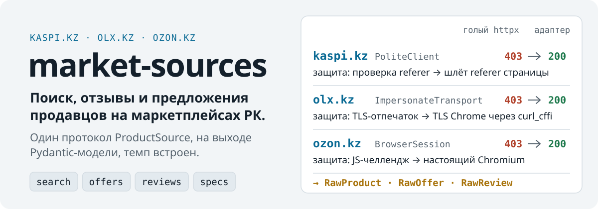
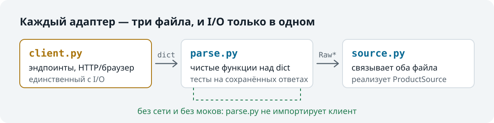

<picture>
  <source media="(max-width: 600px) and (prefers-color-scheme: dark)" srcset="https://raw.githubusercontent.com/octrow/market-sources/main/assets/readme/hero-mobile-dark.ru.svg">
  <source media="(max-width: 600px)" srcset="https://raw.githubusercontent.com/octrow/market-sources/main/assets/readme/hero-mobile-light.ru.svg">
  <source media="(prefers-color-scheme: dark)" srcset="https://raw.githubusercontent.com/octrow/market-sources/main/assets/readme/hero-dark.ru.svg">
  
</picture>

<p align="center">
  <a href="https://github.com/octrow/market-sources/actions/workflows/ci.yml"></a>
  <a href="https://pypi.org/project/market-sources/"></a>
  
  <a href="https://github.com/octrow/market-sources/blob/main/LICENSE"></a>
</p>

<p align="center"><a href="https://github.com/octrow/market-sources/blob/main/README.md">English</a> | <b>Русский</b></p>

Асинхронные скрейперы Kaspi.kz, OLX.kz и Ozon.kz, один протокол.

Найти товар, получить предложения всех продавцов с ценой и доставкой, прочитать отзывы и характеристики.
Подходит для мониторинга цен, ботов со скидками и выбора перед покупкой на маркетплейсах Казахстана.

## Установка

```bash
pip install market-sources                  # Kaspi; для OLX нужен extra impersonate (ниже)
pip install "market-sources[impersonate]"   # + curl_cffi, чтобы WAF OLX.kz пропускал запросы
pip install "market-sources[browser]"       # + playwright, для Ozon.kz
playwright install chromium                 # один раз, для extra browser
```

Через uv: `uv add "market-sources[impersonate,browser]"`.
Свежий код: `pip install "git+https://github.com/octrow/market-sources"`.

Нужен Python 3.12+. Зависимости: `httpx` и `pydantic`.
Extras грузятся лениво, поэтому `import market_sources` работает и без них.

## Пример

<p align="center"></p>

```python
import asyncio
from market_sources import KaspiSource


async def main():
    kaspi = KaspiSource()
    products = await kaspi.search("iphone 15")
    offers = await kaspi.offers(products[0].product_id)
    cheapest = min(offers, key=lambda o: o.price)
    print(products[0].title, "|", len(offers), "offers, from", cheapest.price, cheapest.currency)
    await kaspi.aclose()


asyncio.run(main())
```

Реальный запуск 2026-10-13. Поиск на Kaspi занял 1.4 с и вернул 12 товаров:

```text
Смартфон Apple iPhone 15 128Gb NanoSIM+eSIM черный | 32 offers, from 379500.0 KZT
```

Каждое предложение - обычная Pydantic-модель:

```python
RawOffer(source='kaspi', product_id='113137790', seller='Kaz_Phones', price=379500.0, currency='KZT',
         delivery='EXPRESS', in_stock=True, merchant_rating=4.8, merchant_review_count=32,
         delivery_date='2026-10-13', delivery_cost=995.0, ...)
```

## Источники

- `KaspiSource`: внутренний JSON API Kaspi. Работает на базовой установке.
- `OlxSource`: публичный JSON API OLX. Нужен extra `impersonate`.
- `OzonSource`: composer API Ozon, читается через настоящий браузер. Нужен extra `browser`.
- `KimovilSource`: характеристики телефонов с kimovil.com. Это справочник, а не `ProductSource`.

Все источники реализуют один протокол, так что вашему коду всё равно, с каким сайтом он работает:

```python
class ProductSource(Protocol):
    async def search(self, query: str, city: str | None = None) -> list[RawProduct]: ...
    async def offers(self, product_id: str) -> list[RawOffer]: ...
    async def reviews(self, product_id: str) -> list[RawReview]: ...
    async def specs(self, product_id: str) -> dict[str, str]: ...
```

`city` принимает id площадки или название города. `market_sources.cities` знает 21 город и их id на Kaspi и OLX. Ozon город не учитывает.

Параметры поиска, переменные окружения и список модулей: [docs/sources.ru.md](https://github.com/octrow/market-sources/blob/main/docs/sources.ru.md).

## Как это работает

<picture>
  <source media="(max-width: 600px) and (prefers-color-scheme: dark)" srcset="https://raw.githubusercontent.com/octrow/market-sources/main/assets/readme/adapter-mobile-dark.ru.svg">
  <source media="(max-width: 600px)" srcset="https://raw.githubusercontent.com/octrow/market-sources/main/assets/readme/adapter-mobile-light.ru.svg">
  <source media="(prefers-color-scheme: dark)" srcset="https://raw.githubusercontent.com/octrow/market-sources/main/assets/readme/adapter-dark.ru.svg">
  
</picture>

Адаптер разделяет сеть и разбор, поэтому парсеры тестируются на сохранённых ответах без моков.
Модели хранят то, что сказал сайт. Нормализация, пересчёт валют, дедупликация и ранжирование остаются вам.

- У каждого сайта своя защита: Kaspi проверяет referer, OLX смотрит на TLS-отпечаток, Ozon показывает JavaScript-проверку. Адаптеры проходят все три.
- `PoliteClient` ограничивает параллелизм, добавляет случайные задержки и соблюдает `Retry-After`. `asyncio.gather` по 40 страницам не завалит сайт.
- Scrapy - фреймворк для краулеров. Здесь небольшая библиотека: вызываете её из бота, приложения на FastAPI или cron-скрипта.

Не уменьшайте темп по умолчанию, кэшируйте что можно и соблюдайте правила маркетплейсов.

## Документация

- [Источники, параметры и модули](https://github.com/octrow/market-sources/blob/main/docs/sources.ru.md)
- [Принципы устройства и тесты](https://github.com/octrow/market-sources/blob/main/docs/design-rules.ru.md)
- [Происхождение и отличия от исходного кода](https://github.com/octrow/market-sources/blob/main/docs/origin.ru.md)
- [Карта логики: как запрос становится моделями](https://github.com/octrow/market-sources/blob/main/docs/logic-map.md)
- [Список изменений](https://github.com/octrow/market-sources/blob/main/CHANGELOG.md)

## Как помочь

См. [CONTRIBUTING.ru.md](https://github.com/octrow/market-sources/blob/main/CONTRIBUTING.ru.md). Об уязвимостях сообщайте приватно: [SECURITY.ru.md](https://github.com/octrow/market-sources/blob/main/SECURITY.ru.md).

## Лицензия

[MIT](https://github.com/octrow/market-sources/blob/main/LICENSE)
