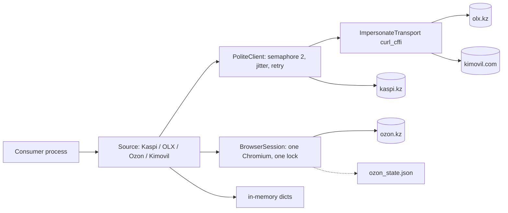

# System design review: market-sources

Kind: Python library (no server, no DB, no CLI). Asyncio scrapers for Kaspi, OLX, Ozon, Kimovil returning `Raw*` models.
Stack, flow, per-site branches: see [logic-map.md](logic-map.md). Not repeated here.

## Assumptions

| Item | Value | Label |
|---|---|---|
| Size | 64 commits, ~3.1k LOC in `src/market_sources`, repo 7.5 MB | measured (git log, wc, du) |
| Activity | 18 commits on 2026-11-01, 3 on 2026-11-05; first 2026-10-30 | measured (git log) |
| Users | 1 owner, consumers are his own projects (buy-smarter, PyPI 0.6.3) | assumed (memory notes) |
| Load | one consumer run issues ~2000 upstream calls/day at most | assumed |
| Latency per upstream call | 0.5 s plus polite delay | assumed (no logs exist; the lib writes none) |
| Response size | ~100 KB | assumed |
| Ozon session | `~/.config/market_sources/ozon_state.json` (3.3 KB) plus an `.expired` copy | measured (ls) |
| Hosting | runs inside the consumer process; consumers deploy on oci-main | assumed |

## 0. What exists

Existing-system mode. Rung today: **below rung 1**. A library has no tier of its own; it inherits the consumer's single process.
Entry points are the public source methods (logic-map "Entry points"). State is in-process only: three per-source LRU-capped dicts (`market_sources/lru.py`) and one 60 s Ozon page cache (logic-map step 7), plus the Ozon cookie file.
No metrics, no logs of timings: the only observability is `logger.warning/debug` lines. So no measured RPS or p95 exists; every latency number is assumed.

## 1. Requirements

One sentence: give a caller normalised-enough raw product, offer, review and spec data from four sites that actively block scrapers, without getting the caller's IP banned.

Functional (core): `search`, `offers`, `reviews`, `specs` per source; Kimovil `lookup`. Out of scope: normalising, caching results, source choice, scheduling (consumer's job).

Non-functional (all assumed unless stated):
- Scale: 1 user, <2k calls/day. No growth path to many users; growth means more cities or sources.
- Latency: nothing interactive. A full OLX sweep in minutes is fine.
- Availability: best effort. Sites change markup or block; a failed call must surface, not hang.
- Consistency: none needed; data is a snapshot.
- Durability: nothing stored except the Ozon session file (0600).
- Politeness is the hard constraint: concurrency 2, 0.5-1.5 s jitter (Kimovil 1.0-2.5 s) are a requirement, not a tuning knob.
- Security: Ozon cookies are credentials; proxies come from args/env.
- Observability: weak (see risks).

## 2. Napkin math

Throughput is set by the politeness knobs, not by hardware. Run for a heavy single consumer:

```
$ napkin.py --dau 1 --req-per-user 2000 --peak 1 --server-rps 1 --read-share 1 --hit-rate 0 --response-kb 100 --retention-years 1
requests/day ............ 2.0k      average ... 0.0 req/s
servers @ 1 req/s, 70% util, +1 spare ... 2   (script minimum, meaningless for a library)
egress at peak .......... 18.5 kbit/s     storage .... 0.0B
verdict: rungs 1-2: one good VPS. Ship it.
```

Library-specific ceilings (arithmetic in python3, inputs assumed):

```
HTTP ceiling = concurrency 2 / (1.0 s mean delay + 0.5 s latency) = 1.33 req/s
OLX one 1000-result slice (20 pages @ 50)        = 15 s
OLX search_all with 10 slices (200 pages)        = 150 s
Kimovil lookup worst case (5 autocomplete + 1 page, 1.75 s delay + 0.5 s) = 13.5 s
OLX _offer_cache, 1000 listings x ~6 KB          = ~6 MB per search (assumed size)
```

The shared 2 req/s-class ceiling is per `PoliteClient`; each city or region gets its own client (logic-map step 2), so N cities multiply concurrency and ban risk by N. Napkin says the compute side is irrelevant; the rate limit and the WAF are the capacity.

## 3. API contract

n/a as HTTP. The contract is the `ProductSource` Protocol (`base.py`): `search/offers/reviews/specs`, raw models, `None` for unknown. Idempotency: all calls are reads; POST for Kaspi offers is retried deliberately (logic-map step 5).

## 4. High-level architecture

Rung 0/1: in-process library, no extra boxes. Only what exists:



- PoliteClient: the politeness requirement; one semaphore per client bounds blast radius.
- ImpersonateTransport: OLX and Kimovil WAFs fingerprint TLS; without it they return 403.
- BrowserSession: Ozon's JS challenge; serialised because one page is reused. Idle close at 600 s frees ~300 MB (per its docstring).
- In-memory dicts: later calls (`offers`, `specs`) reuse a search's data and save requests.
- No queue, cache server or DB. A queue is the consumer's decision.

## 5. Data

No database. Storage is process memory plus one file.
- Kaspi: `product_id -> configSku/cityId`, `(query, city) -> facets` (`kaspi/source.py:64`); small, LRU-capped.
- OLX: full raw listing per id (`olx/source.py:63,70,241`). Grows by up to 1000 listings per query, LRU-capped at 5000 entries; the only structure that can reach tens of MB in a long-lived process.
- Ozon: one page payload for 60 s (`ozon/source.py:33`).
- Cache pattern: read-through memo without TTL (Kaspi, OLX) and TTL 60 s (Ozon). Invalidation: none; `aclose` does not clear them (logic-map step 12). Process restart is the reset.
- Result caching across runs (TTL, sqlite) belongs to the consumer; a library-level cache is not justified at 2k calls/day.

## 6. Scale and failure

x10 traffic (20k calls/day):
- First to saturate: the per-client politeness ceiling, 1.33 req/s = ~115k calls/day theoretical (assumed latency), so volume is fine; ban risk and OLX's 1000-result cap bind earlier. Sweeps of 200 pages take 150 s, so ten sweeps/day is 25 min of wall time, one process.
- Ozon is the true bottleneck: one browser, one lock, ~1-10 s per navigation (assumed), strictly serial, plus session expiry.
- Next rung: consumer runs several processes with distinct proxies, results cached in the consumer's DB. Trigger: sustained 429/403 rate above ~5% of calls, or consumer run wall time over the schedule window.

Failures:
- Upstream takes 8 s: timeouts 10/15/20 s then 1 retry; the semaphore slot is held through the whole attempt and backoff (logic-map step 4), so 2 slow calls stall the client. Worst case per call ~2 x timeout + delay + backoff, about 50 s for Kimovil.
- No circuit breaker: after a block, the next call tries again. A banned IP gets hammered at the full rate by a consumer loop.
- Retries: 1 retry, `Retry-After` clamped to 30 s, else 1 s x 2^n with 25% jitter. Sensible for a polite scraper.
- Browser crash or challenge fail: teardown and one relaunch; navigation timeout (90 s) is not retried.
- Ozon session expiry: raises `OzonSessionExpired`; recovery is manual (`bootstrap`, headed browser). An `.expired` copy exists, so it has already happened.
- Single VM gone: nothing to lose; no state to restore except the cookie file (not backed up; re-bootstrap).
- Backups: n/a. Restore rehearsal: re-run `bootstrap` for Ozon.

## 7. Trade-offs

- Politeness vs throughput: fixed low concurrency and delays protect IPs and cost minutes per sweep. Correct for one user.
- Fail loud vs partial: HTTP errors propagate, but `search_all` skips failed pages with a warning, so a sweep can silently return fewer rows.
- Memory vs requests: in-memory memo dicts save re-fetches; LRU caps bound them (OLX up to ~30 MB), an evicted entry costs a re-fetch or, in Kaspi, a fallback to the default id/city.
- Raw output vs normalised: keeps the library thin, pushes work onto every consumer.
- Browser vs HTTP for Ozon: Chromium is the only way through the challenge; costs ~300 MB RAM and serial access.
- Optional extras (curl_cffi, selectolax, playwright): small install, but missing one degrades silently to 403 or ImportError at first call (logic-map step 1).

## 8. Summary

Design in three lines: a thin async library, per-site client with fixed politeness limits, one serial Chromium for Ozon. It holds the real load (one user, ~2k calls/day) by orders of magnitude; the limit is the sites' anti-bot, not compute. What breaks first at x10 is Ozon's serial browser and ban rate, then OLX's 1000-result cap.

Assumptions that would change it: multiple concurrent consumers sharing one IP, a long-lived server consumer (memory growth, need for TTL), call volume above ~100k/day.

Next rung: consumer-side result cache plus proxy pool. Trigger: 403/429 above ~5% of calls over a day, or any consumer process living more than a day (RSS growth from the dicts).

## Risks

- ✅ 2026-11-05 MEDIUM, `olx/source.py`: `_offer_cache` now an LRU capped at 5000 entries (~30 MB worst case); not committed.
- ✅ 2026-11-05 MEDIUM, `kaspi/source.py`: `_facets` and the sku/city maps now LRU-capped; not committed.
- MEDIUM, `src/market_sources/polite_http.py:229`: the semaphore is held across retry sleeps and timeouts; with `Retry-After` up to 30 s two blocked calls stall the whole client. No circuit breaker, so a banned IP keeps being hit. Add a cooldown after N consecutive 403/429.
- MEDIUM, `src/market_sources/olx/source.py:174`: `search_all` fans out all pages in one gather per sweep; per-client semaphore bounds the rate, but per-city clients multiply concurrency, and skipped pages make results silently incomplete (see logic-map step 3).
- MEDIUM, `src/market_sources/playwright_session.py` (nav lock, idle timer): Ozon is serial and depends on a manual cookie bootstrap that has already expired once (`ozon_state.json.expired`); no alert, no automatic fallback. Not in logic-map as a scaling risk.
- LOW, `src/market_sources/ozon/source.py:33`: 60 s page cache shared by `offers` and `specs`; a consumer calling them more than 60 s apart pays two navigations.
- LOW, whole package: no timing or status metrics, so p95 and block rates cannot be measured; add one debug log per request with status and elapsed time.
- LOW, `~/.config/market_sources/ozon_state.json`: session cookies are not backed up; recovery needs a human with a display.
